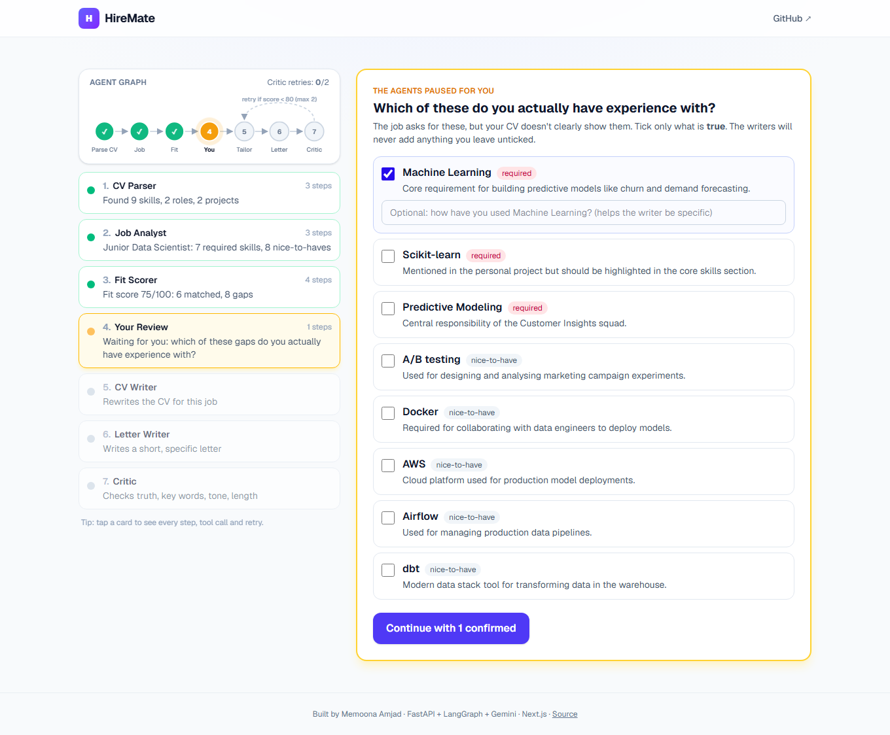
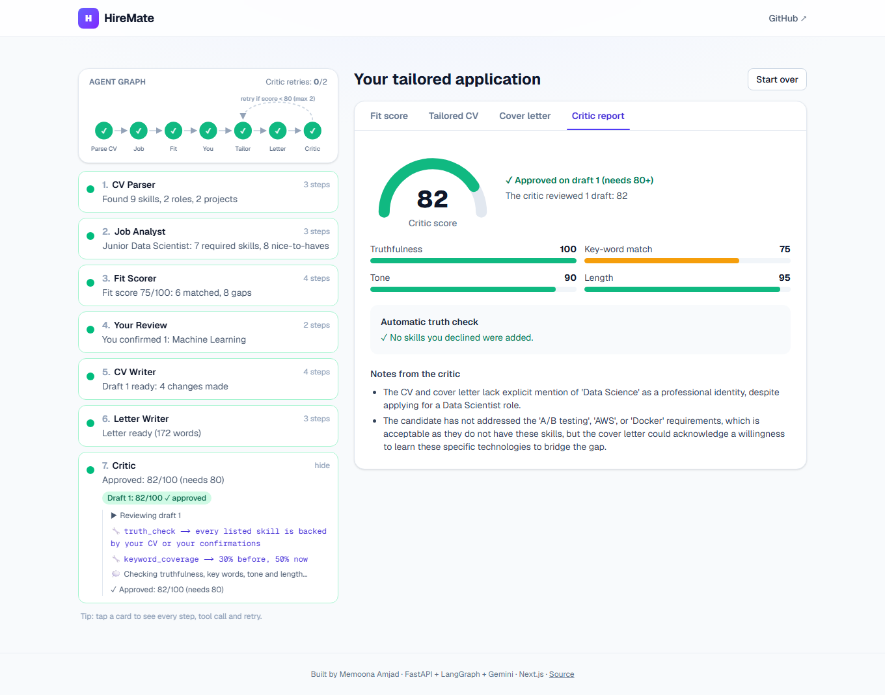
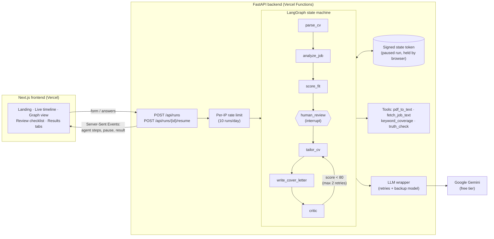

# HireMate

**A team of AI agents that tailors your CV and cover letter to a job, asks before changing anything, and checks its own work.**

**Live demo:** _coming soon_ · click **"Try with a sample"**, no upload needed.



---

## The problem

Tailoring a CV and cover letter for every job takes hours. Generic AI tools save time but
often **invent experience**, which can cost a candidate the job when it comes out at interview.
HireMate does the tailoring in about two minutes and **only uses facts the candidate has confirmed**.

## What the agents do

1. **CV Parser** reads the CV (pasted or PDF) into structured data: skills, roles, education, projects.
2. **Job Analyst** reads the job post (pasted or fetched from a link) and finds required skills, nice-to-haves, seniority and key words.
3. **Fit Scorer** gives a 0–100 fit score, matched skills, missing skills and quick wins.
4. **Human review (you).** The agents **pause** and ask: *"Which of these gaps do you actually have experience with?"* Nothing you leave unticked is ever added.
5. **CV Writer** rewrites the CV for this job using only true, confirmed facts.
6. **Letter Writer** writes a short, specific cover letter.
7. **Critic** checks truthfulness, key words, tone and length, and scores the work. Below 80, it **sends the draft back** to the CV Writer with feedback (max 2 retries).

Every step streams live to the screen: what each agent is thinking, which tools it calls, and every retry.



## Architecture



**Why it is built this way**
- **LangGraph** makes the flow an explicit graph: easy to explain, test and extend. Its **interrupt** pauses the run for the human.
- **A stateless backend.** When the run pauses, the server packs its state into a **signed token** (HMAC) and gives it to the browser. On resume, the server checks the signature (so it can't be tampered with) and continues. No server memory is needed between requests, so it runs on serverless hosting and scales out freely.
- **Structured output.** Every agent answers in a strict schema (Pydantic), so agents pass clean data to each other rather than free text.
- **A truth check that isn't just another LLM.** Plain code flags any skill the user declined. That check overrides the critic's score, so a draft that claims one can never pass.
- **Server-Sent Events** stream each agent step to the browser as it happens.

## Tech stack

| Layer | Tools |
|---|---|
| Agents | Python 3.12, LangGraph, Pydantic, Google Gemini (`google-genai` SDK) |
| API | FastAPI, Server-Sent Events (`sse-starlette`), `pypdf`, `httpx` + `trafilatura` |
| Frontend | Next.js (App Router), TypeScript, Tailwind CSS, framer-motion, react-markdown |
| Hosting | Vercel (frontend + Python backend as two projects, free Hobby plan). A `Dockerfile` is included for any container host. |
| Tests | pytest (graph, API, tools; uses a fake LLM, so no API key needed) |

## Run locally (Windows)

You need Python 3.12, Node 20+ and a free Gemini API key from https://aistudio.google.com/apikey.

**1. Backend** (PowerShell, from the repo folder):
```powershell
cd backend
py -3.12 -m venv .venv
.venv\Scripts\activate
pip install -r requirements.txt
copy .env.example .env      # then open .env and fill in GEMINI_API_KEY and LLM_MODEL
uvicorn app.main:app --reload --port 8000
```

Try the agents from the command line on the bundled sample (no frontend needed):
```powershell
python cli.py
```

Run the tests:
```powershell
pytest
```

**2. Frontend** (a second terminal):
```powershell
cd frontend
npm install
copy .env.example .env.local   # set NEXT_PUBLIC_API_URL=http://localhost:8000
npm run dev
```
Open http://localhost:3000 and click **Try with a sample**.

## Limitations and next steps

- **Free AI capacity.** The demo runs on Gemini's free tier, which is sometimes overloaded (HTTP 503) or rate-limited. The app retries with a backup model and shows this in the timeline, but a run can still fail at busy times. A paid key removes this.
- **Lite models.** The free "flash" model allows only ~20 requests a day, so the demo uses `gemini-3.5-flash-lite`. A stronger model would write better drafts (it is one setting: `LLM_MODEL`).
- **Rate limit is per server instance.** The backend is stateless (paused runs travel as signed tokens), but rate-limit counts live in each instance's memory, so the 10-runs-a-day limit is approximate on serverless hosting. Next step: a shared store (e.g. Redis).
- **5-minute limit per step.** Each request on Vercel's free plan can run for at most 5 minutes. A normal run takes 1–2 minutes, but a very busy AI service could push past that.
- **Truth check is word-based.** It catches declined skills reliably, but can't judge every rewording. The critic LLM covers the rest. Next step: claim-by-claim evidence linking.
- **PDF download** uses the browser's "Save as PDF" print dialog, chosen for reliability. Next step: designed CV templates.
- **Job links.** Many job sites (e.g. LinkedIn) block automated readers. The agent then asks the user to paste the text.
- Next features: a side-by-side diff of original vs tailored CV, a tracker for many applications, and evaluation runs on a set of sample CVs.

---

Built by **Memoona Amjad** · [GitHub](https://github.com/Memoona-Amjad)
